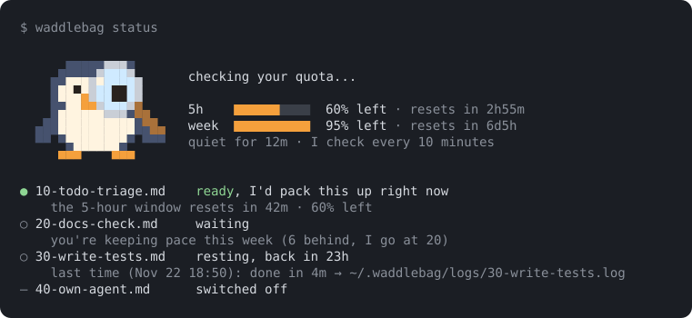

<p align="center">
  
</p>

<h1 align="center">waddlebag</h1>

<p align="center">
  Your Claude subscription quota resets whether you used it or not.<br>
  waddlebag spends what's left on jobs you choose, before it expires.
</p>

<p align="center">
  
</p>

## Install

```bash
pip install git+https://github.com/toeric/waddlebag
waddlebag setup
```

You need macOS, Python 3.11+, and [Claude Code](https://claude.com/claude-code) logged in.

If `pip` refuses to install into your system Python, use `pipx install` or `uv tool install` with the same address.

## Write a job

A job is one text file in `~/.waddlebag/tasks/`. `setup` puts the first one there for you:

```markdown
---
when: leftover
in: ~/path/to/your/repo
enabled: false
---
Find the TODO and FIXME comments in this repository.
Pick the five that are most worth fixing.
```

It has three parts: **when** to run, **in** which folder, and the text that says what to do.

Change the folder, set `enabled: true`, and you are done. waddlebag checks your quota every 10 minutes, hands the text to Claude Code when the moment comes, and saves the answer in `~/.waddlebag/logs/`.

## When to run

| Write | Runs when |
|---|---|
| `when: leftover` | the 5-hour window resets within an hour and at least 30% is left |
| `when: idle` | nobody has used Claude for an hour |
| `when: behind` | you are using your weekly quota slower than the week is passing |

You can also [write your own numbers](docs/reference.md#conditions).

## Commands

| Command | What it does |
|---|---|
| `waddlebag setup` | Checks your environment and starts the 10-minute schedule |
| `waddlebag status` | Shows your quota and what each job is waiting for |
| `waddlebag run` | Checks once, right now. `waddlebag run <job>` runs that job immediately |

## Examples

`setup` copies these into `~/.waddlebag/tasks/examples/`. To use one, copy it up into `~/.waddlebag/tasks/`.

| Example | What it does |
|---|---|
| [todo-triage.md](src/waddlebag/examples/todo-triage.md?plain=1) | Lists the five TODO comments most worth fixing |
| [docs-check.md](src/waddlebag/examples/docs-check.md?plain=1) | Finds places where the README no longer matches the code |
| [write-tests.md](src/waddlebag/examples/write-tests.md?plain=1) | Writes tests for the least-tested file |
| [run-skill.md](src/waddlebag/examples/run-skill.md?plain=1) | Runs one of your own Claude Code skills |
| [review-commits.md](src/waddlebag/examples/review-commits.md?plain=1) | Pipes the latest commits to Claude for review |
| [own-agent.md](src/waddlebag/examples/own-agent.md?plain=1) | Hands the job to a program of your own instead of Claude |

## Good to know

- **Jobs can only read, by default.** Nobody is there to click "allow", so Claude may only use the tools a job lists. Add `tools: Read, Grep, Glob, Edit, Write` to let a job change files.
- **Your own agent works too.** Add `run: python3 my_agent.py` and the text goes to that command instead of Claude Code.
- **The computer must be awake.** The schedule does not run while a Mac sleeps.

Everything else is in the [reference](docs/reference.md).

<p align="center">
  
</p>

## License

[MIT](LICENSE)
